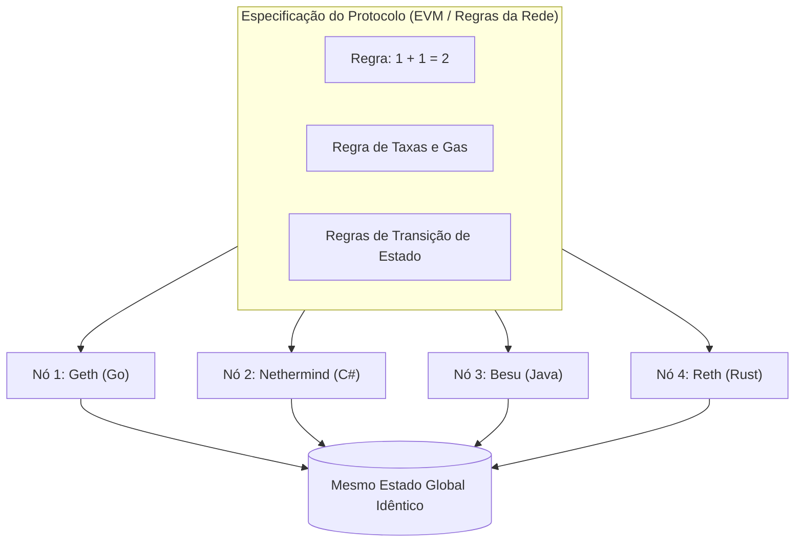

# Módulo 01: O que é Descentralização, Nós e Transparência Radical

> *"Na Web2 você pede permissão e confia no recibo. Na Web3 você apresenta uma prova matemática e a rede inteira confere."*

---

## 1. Desmistificando a "Descentralização"

No imaginário popular, "descentralizado" soa como anarquia ou ausência de regras. Na ciência da computação e em sistemas distribuídos, é exatamente o oposto: **é a aplicação de regras tão rígidas e universais que nenhum participante precisa de autoridade especial para que o sistema funcione.**

### Centralizado vs. Descentralizado na Prática

| Aspecto | Modelo Centralizado (Web2 / Bancos Tradicionais) | Modelo Descentralizado (Web3 / Blockchains EVM) |
| :--- | :--- | :--- |
| **Quem guarda a verdade** | Um servidor central ou cluster privado (AWS, servidores do banco). | Milhares de computadores independentes (nós/nodes) espalhados pelo mundo. |
| **Como o saldo muda** | Uma chamada SQL privada (`UPDATE contas SET saldo = saldo - 100`). | Uma transação criptograficamente assinada processada pela máquina de estado. |
| **Acesso ao banco** | Fechado. Apenas funcionários autorizados e APIs controladas enxergam as tabelas. | **Público e aberto.** Qualquer pessoa pode baixar e auditar cada byte do estado. |
| **Ponto único de falha** | Se o datacenter cair ou a empresa confiscar sua conta, o serviço acaba. | Se 90% dos nós forem desligados, os 10% restantes mantêm o sistema 100% funcional. |

---

## 2. A Chave do Jogo: Softwares Compatíveis Rodando as Mesmas Regras

Para que milhares de pessoas ao redor do mundo mantenham exatamente o mesmo "banco de dados" sem uma autoridade central dizendo quem está certo, existe um pilar fundamental: **especificação de protocolo e clientes de execução.**

### O que significa "rodar um nó"?
Um nó (node) é simplesmente um computador rodando um programa que:
1. Conecta-se a outros computadores da rede via P2P (Peer-to-Peer).
2. Baixa as transações e blocos transmitidos pelos colegas.
3. **Executa localmente** cada transação usando sua própria CPU e memória.
4. Atualiza seu banco de dados local com o novo estado.

### Diversidade de Clientes: Por que a linguagem não importa
No Ethereum, por exemplo, o software não é um único executável monopolista. Existem implementações escritas em **Go (Geth)**, **C# (Nethermind)**, **Rust (Reth)** e **Java (Besu)**.

Apesar de serem códigos-fonte completamente diferentes, todos eles implementam a mesma especificação matemática (a EVM - Ethereum Virtual Machine). Se você rodar uma transação no Geth ou no Reth, o resultado em disco tem que ser **bit a bit idêntico**. Se um software gerar um resultado diferente, ele é considerado defeituoso e a rede o rejeita automaticamente.

---

## 3. Por que a Transparência é o Escudo da Descentralização?

Muitos perguntam: *"Por que a blockchain tem que ser aberta a ponto de qualquer pessoa ver os saldos e as transações de todo mundo?"*

A resposta não tem a ver com exibicionismo: **transparência é a única ferramenta que elimina a necessidade de confiança.**

### O Dilema da Caixa Preta (Web2)
Quando você consulta o saldo no seu aplicativo bancário:
- O app mostra: `Saldo: R$ 5.000,00`.
- Você **acredita** porque confia na instituição e nas leis do país.
- Mas você não tem como auditar se o banco realmente possui aquela reserva em caixa naquele segundo ou se emprestou 95% do seu dinheiro no mercado fracionário. Você não vê o código nem o banco de dados.

### A Verificação Universal (Web3)
Na blockchain não existe caixa preta:
1. **Regras públicas:** O código de cada contrato inteligente e as regras da EVM são públicos.
2. **Histórico auditável:** Desde o bloco gênese (bloco 0) até o bloco atual, todo movimento de satoshi ou wei é registrado.
3. **Auditoria em tempo real:** Se alguém tentar "inventar dinheiro do nada" ou criar uma transação sem saldo suficiente, o seu nó local vai rodar a transação, perceber que `saldo_anterior < valor_enviado`, emitir um erro e **rejeitar o bloco na hora**.

> 🛡️ **Conclusão:** Você não precisa confiar no minerador, no validador ou no criador da rede. A transparência permite que **você mesmo calcule a verdade**. Se a rede fosse opaca, a descentralização seria impossível, pois você dependeria do relato de terceiros.

---

## 4. O que compõe as Informações da Cadeia?

Quando um nó sincroniza a blockchain, ele mantém duas coisas fundamentais:

1. **O Histórico (A Fita de Gravação):**
   - Lista sequencial de todos os blocos já minerados/validados.
   - Cada bloco contém a lista de transações executadas nele e o hash do bloco anterior.
   - É *append-only* (só cresce, nunca apaga nem reescreve).

2. **O Estado Atual (A Foto do Momento):**
   - É o resultado acumulado de todas as transações da história até o bloco mais recente.
   - Mapeia:
     - Qual é o saldo de cada endereço.
     - Qual é o nonce (contador de transações) de cada conta.
     - Qual é o código de bytecode de cada contrato inteligente.
     - Quais são os valores armazenados nas variáveis de cada contrato (*storage*).

Quando interagimos com o DeFi ou compramos um item em um contrato inteligente, estamos propondo uma alteração nesse **Estado Atual**. E é exatamente sobre como essa proposta vira realidade que falaremos no próximo módulo.
