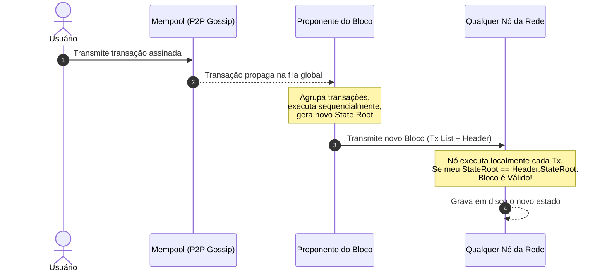

# Módulo 02: Como a Informação Entra no Bloco e a Verificação Determinística

> *"Don't trust, verify (Não confie, verifique). Mas como um computador sem sentimentos realmente verifica algo do outro lado do planeta?"*

---

## 1. O Ciclo de Vida da Informação: Da Intenção ao Bloco

Quando você clica em "Comprar Card" na interface ou envia tokens, a informação passa por um caminho muito bem definido antes de se tornar história permanente.



### Passo 1: A Mempool (Sala de Espera)
Sua transação não vai direto para a blockchain. Ela é anunciada aos nós vizinhos e entra na **mempool** (memory pool), uma área de memória volátil onde transações válidas aguardam serem incluídas em um bloco.

### Passo 2: O Limite de Gas do Bloco
Um bloco não tem tamanho infinito. Ele possui um teto de processamento (medido em **Gas**, tipicamente 30 milhões de gas por bloco no Ethereum). Isso impede que alguém envie uma transação com um loop infinito que trave todos os computadores da Terra. Cada instrução computacional custa gas.

### Passo 3: O Empacotamento
O nó responsável por propor o bloco seleciona um conjunto de transações da mempool, ordena essas transações e as executa uma a uma.

---

## 2. A Mágica do Determinismo: A Função de Transição de Estado

A blockchain pode ser resumida em uma única fórmula matemática pura:

$$S_{n} = \text{APPLY}(S_{n-1}, T)$$

Onde:
- **$S_{n-1}$**: É o estado da rede antes do bloco (quem tem quanto dinheiro, quais variáveis estão salvas nos contratos).
- **$T$**: É a lista ordenada de transações contidas no bloco.
- **$\text{APPLY}$**: É a máquina de execução (a EVM - Ethereum Virtual Machine).
- **$S_{n}$**: É o novo estado da rede.

### O que significa ser "Determinístico"?
Significa que **não existe aleatoriedade, subjetividade ou dependência externa**.
- Não existe `Math.random()`.
- Não existe chamada de API externa (`fetch("https://api.cotacao.com")`) dentro da EVM.
- Se 10.000 computadores em países diferentes pegarem o estado $S_{n-1}$ e executarem a lista $T$ na mesma ordem, **todos os 10.000 computadores obrigatoriamente chegarão ao mesmíssimo estado $S_{n}$**.

---

## 3. Como Cada Nó Faz a Verificação Sem Baixar Gigabytes de Dados?

Se cada bloco adiciona transações e altera saldos de centenas de pessoas, como a rede valida isso sem ter que transferir o banco de dados inteiro a cada 12 segundos?

A resposta é o **Cabeçalho do Bloco (Block Header)** e as **Árvores Criptográficas (Merkle Trees)**.

```text
┌────────────────────────────────────────────────────────┐
│                      BLOCK HEADER                      │
├────────────────────────────────────────────────────────┤
│ Parent Hash:      0x8f4c...                            │
│ Number:           21.450.812                           │
│ Timestamp:        1794238284                           │
│ Gas Used:         14.820.310                           │
│ TransactionsRoot: 0x3a91... (Resumo das Txs do bloco)  │
│ StateRoot:        0x9f12... (Resumo de TODAS as contas)│
└────────────────────────────────────────────────────────┘
```

### O `stateRoot` (A Impressão Digital do Planeta)
O `stateRoot` é uma hash criptográfica de 32 bytes (256 bits). Esse minúsculo código representa a "foto" exata de todos os saldos, códigos e memórias de todos os contratos existentes no mundo naquele exato instante.
Se um único saldo mudar em 1 centavo (1 wei), essa hash muda por completo.

### O Teste da Prova Local:
Quando o proponente envia o bloco para a rede, ele **não envia os novos saldos**. Ele envia apenas:
1. O cabeçalho com o `stateRoot` que ele alega ter obtido.
2. A lista de transações $T$.

Quando o seu nó recebe esse bloco:
1. Ele pega o seu estado local confiável do bloco anterior ($S_{n-1}$).
2. Roda as transações $T$ no seu próprio processador.
3. Calcula a hash raiz resultante no final da execução.
4. **Compara:**
   - A minha hash calculada é igual à hash informada no cabeçalho do proponente?
   - **Sim?** O bloco é matematicamente legítimo. O nó grava em disco e propaga.
   - **Não?** O proponente tentou trapacear (ou teve uma falha de hardware). O nó simplesmente joga o bloco no lixo e nem sequer repassa para a frente.

> 🚫 **Nenhum nó precisa de permissão ou de votação humana:** A matemática do hash descarta fraudes de forma instantânea, automática e descentralizada.
