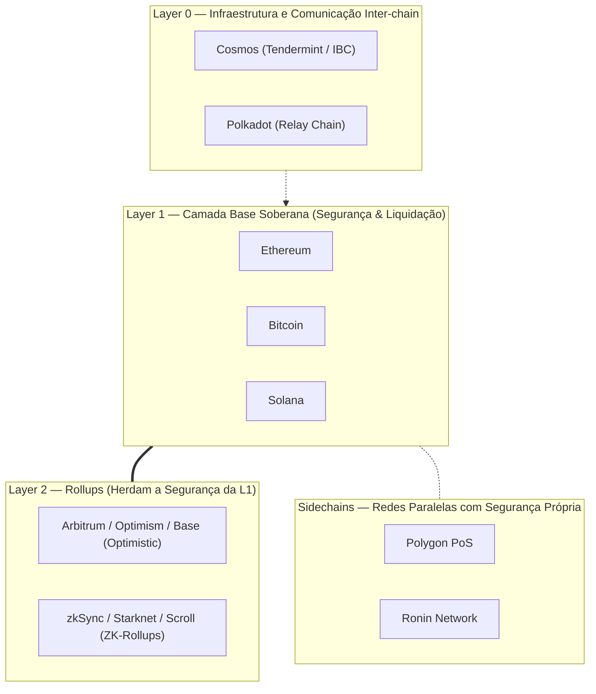

# Módulo 03: Infraestrutura — Camadas (L0, L1, L2, Sidechains) e o Perigo das Pontes

> *"Blockchains são ilhas soberanas e totalmente cegas para o mundo exterior. Toda vez que alguém tenta construir uma ponte entre duas ilhas, cria-se o maior alvo de hackers da história da computação."*

---

## 1. A Torre de Camadas (Layers): Do L0 às Redes de Aplicação

Para entender DeFi, é preciso entender em qual terreno estamos construindo. Nem toda rede blockchain possui o mesmo nível de segurança, descentralização ou autonomia.



### Quadro Comparativo de Arquitetura

| Camada | Exemplos | Onde o Consenso Acontece? | O que acontece se os validadores coludirem? |
| :--- | :--- | :--- | :--- |
| **Layer 0 (L0)** | Cosmos, Polkadot | Camada de transporte / relay que conecta blockchains independentes. | Redes filhas podem ter seguranças independentes ou compartilhadas. |
| **Layer 1 (L1)** | Ethereum, Bitcoin, Solana | **Na própria rede.** Possui seus próprios validadores/mineradores e token nativo de gas soberano. | Requer um ataque de 51% na rede global (custo econômico de bilhões de dólares). |
| **Layer 2 (L2)** | Arbitrum, Base, Optimism, zkSync | A execução é rápida fora da L1, mas **o resumo e as provas são postados na L1**. | **Você não perde fundos.** Mesmo que a L2 trave, as regras da L1 permitem forçar o saque de volta para a L1 (herda a segurança da L1). |
| **Sidechain** | Polygon PoS, Ronin | **Num conjunto próprio de validadores**, paralelo e separado da L1. | **Risco total.** Se o comitê de validadores da sidechain for corrompido, seus fundos podem ser roubados e a L1 nada pode fazer. |

---

## 2. O Mito do "Teletransporte" e Como as Pontes (Bridges) Realmente Funcionam

Muitos usuários acham que quando "mandam ETH do Ethereum para a Arbitrum ou Polygon", os tokens viajam por um tubo de fibra ótica. 

**Isso é impossível.** Um contrato no Ethereum não pode alterar a memória de um nó na Polygon, e vice-versa. As redes operam com bancos de dados isolados.

### O Mecanismo Clássico: *Lock & Mint / Burn & Unlock*

```text
  REDE DE ORIGEM (Ethereum L1)                      REDE DE DESTINO (Polygon / Ronin)
┌───────────────────────────────┐                 ┌───────────────────────────────┐
│  Usuário envia 10 ETH         │                 │                               │
│            ▼                  │                 │                               │
│  [COFRE DO SMART CONTRACT]    │                 │                               │
│  🔒 10 ETH ficam BLOQUEADOS   │                 │                               │
└──────────────┬────────────────┘                 └───────────────▲───────────────┘
               │                                                  │
               │  1. Oráculos / Relayers escutam o evento         │
               │  2. Assinam uma autorização off-chain            │
               └───────────────────────┬──────────────────────────┘
                                       ▼
                        [CONTRATO DA PONTE NO DESTINO]
                        🖨️ EMITE (MINT) 10 wETH (Wrapped ETH)
```

1. **Na Origem:** O seu ativo real fica preso em uma conta de contrato ("Cofre / Vault").
2. **No Trânsito:** Mensageiros off-chain (relayers, validadores multi-sig ou nós de ponte) detectam o depósito e assinam uma mensagem atestando que os fundos foram travados.
3. **No Destino:** O contrato da ponte na outra rede recebe a assinatura e "imprime do nada" um token sintético espelho (*Wrapped Token* como wETH, renBTC, etc.).
4. **Na Volta:** O processo inverte: o token espelho é queimado (*burned*) no destino e o cofre na origem abre a tranca (*unlocked*).

---

## 3. Por que as Pontes Viraram o Maior Cemitério de Bilhões da Web3?

As pontes concentram dois pontos críticos de perigo:
1. **O Efeito Pote de Ouro (Honeypot):** O contrato do cofre na L1 guarda centenas de milhões ou bilhões de dólares em criptoativos reais parados no mesmo endereço.
2. **A Dependência Off-Chain:** A ponte depende de um software externo ou de poucas chaves que ligam os dois mundos.

### Autópsia dos Maiores Hacks da História

#### 1. Ronin Bridge (Axie Infinity) — ~$624 Milhões (Março de 2022)
- **Vetor:** Engenharia social e vazamento de chaves privadas.
- **O que houve:** A ponte era controlada por um comitê multi-sig de apenas 9 validadores, onde 5 assinaturas bastavam para liberar saques. O grupo hacker Lazarus (Coreia do Norte) comprometeu 4 chaves da Sky Mavis através de falsas propostas de emprego em PDF e obteve a 5ª chave através de uma permissão temporária esquecida pela Axie DAO.
- **Lição:** O código do contrato inteligente estava perfeito. Mas a infraestrutura de validação off-chain era frágil e centralizada.

#### 2. Wormhole Bridge (Solana ↔ Ethereum) — ~$326 Milhões (Fevereiro de 2022)
- **Vetor:** Falha de lógica em contrato inteligente (Solana).
- **O que houve:** O invasor explorou um bug na função de verificação de assinaturas dos "guardiões" da Wormhole. O contrato não verificou adequadamente se a instrução de checagem do sistema (`sysvar::instructions`) era legítima. O hacker forjou uma assinatura válida e conseguiu cunhar 120.000 wETH na Solana sem ter depositado 1 centavo no Ethereum.
- **Lição:** Uma única linha de validação frouxa permite que ativos sintéticos sejam impressos do nada, quebrando a paridade (peg).

#### 3. Nomad Bridge — ~$190 Milhões (Agosto de 2022)
- **Vetor:** Erro infantil de inicialização em deploy/upgrade.
- **O que houve:** Durante uma atualização de rotina, a equipe da Nomad configurou o valor raiz padrão de mensagens confirmadas como `0x00...000`. Como mensagens não processadas também tinham hash zero, o contrato passou a considerar qualquer mensagem como "previamente aprovada". Centenas de pessoas e bots simplesmente copiaram a transação do invasor original, substituíram o endereço da carteira pelo seu próprio e esvaziaram a ponte como uma multidão saqueando uma loja com as portas abertas.
- **Lição:** Upgrades de contratos em sistemas inter-chain carregam risco catastrófico.

---

## 4. O Efeito Dominó do Risco de Pontes no DeFi

Se um protocolo de empréstimo (ex: Aave ou Compound) em uma Layer 2 ou Sidechain aceitar um token "wETH" como colateral:
- Se a ponte for hackeada e o cofre de ETH real na L1 for drenado, o "wETH" na L2 perde completamente o lastro.
- O valor do wETH cai para zero.
- Os usuários que pegaram empréstimos de USDC usando wETH como garantia simplesmente não pagam a dívida, deixando o protocolo de empréstimo insolvente com um rombo impagável.

Entender onde o código e o dinheiro residem é o primeiro mandamento de segurança em DeFi. No próximo módulo, vamos mergulhar na unidade fundamental de onde tudo isso acontece: **o Smart Contract.**
