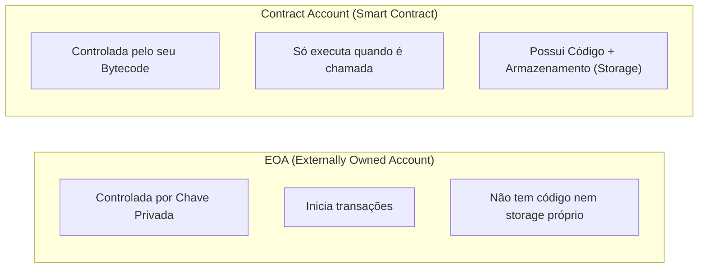

# Módulo 04: Anatomia de um Smart Contract — O Código que Mora no Estado

> *"Nick Szabo descreveu em 1994 o smart contract original como uma simples máquina de refrigerante: você insere a moeda, aperta o botão e a máquina entrega o produto se o valor for suficiente. Sem intermediários, sem gerente de banco, sem negociação."*

---

## 1. O que é uma Conta na EVM?

Para entender um contrato inteligente, primeiro você precisa entender que no Ethereum só existem dois tipos de contas:



1. **EOA (Externally Owned Account):** É a carteira que o usuário usa (MetaMask, Rabby). Possui chave privada, nonce e saldo em ETH. Pode iniciar transações.
2. **Contract Account (Conta de Contrato):** **Não tem chave privada nem senha.** Ela possui um endereço público, saldo em ETH, um bloco de **bytecode imutável** gravado na blockchain e uma área de memória persistente chamada **Storage**. Ela é 100% autônoma e só executa instruções quando recebe uma transação ou uma chamada de outra conta.

---

## 2. A Anatomia Interna de um Contrato

Quando escrevemos um contrato em Solidity e compilamos, geramos duas coisas:
1. **Bytecode:** As instruções em linguagem de máquina da EVM (opcodes como `PUSH1`, `MSTORE`, `SLOAD`, `SSTORE`, `JUMP`).
2. **ABI (Application Binary Interface):** O manual de instruções em JSON que diz ao frontend quais funções existem, quais parâmetros recebem e o que retornam.

```text
┌──────────────────────────────────────────────────────────────┐
│                    SMART CONTRACT ACCOUNT                    │
├──────────────────────────────────────────────────────────────┤
│ Endereço: 0x71C...                                           │
│ Saldo:    2.45 ETH                                           │
├──────────────────────────────────────────────────────────────┤
│ BYTECODE (Código de Execução)                                │
│ PUSH1 0x80 PUSH1 0x40 MSTORE CALLVALUE ... (Lógica imutável) │
├──────────────────────────────────────────────────────────────┤
│ STORAGE (Banco de Dados Chave-Valor Persistente)              │
│ Slot 0:  Endereço do Dono (Owner)                            │
│ Slot 1:  Preço do Card #1                                    │
│ Slot 2:  Estoque do Card #1                                  │
│ ...      Mapas de saldos e donos de tokens                   │
└──────────────────────────────────────────────────────────────┘
```

---

## 3. O que acontece quando você chama uma função?

Quando você clica no botão "Comprar" na Vending Machine, a sua carteira monta uma transação com um campo chamado **`data`** (ou `calldata`).

Exemplo: chamando `buyCard(cardId: 5)` (sempre 1 unidade) com envio de `0.001 ETH`:

1. **O Function Selector (Os primeiros 4 bytes):**  
   A EVM pega a assinatura da função: `keccak256("buyCard(uint256)")`.  
   Os primeiros 4 bytes dessa hash (ex: `0x9a4f21d3`) são usados como um despachante de tráfego (*dispatcher*). O contrato olha esses 4 bytes e sabe exatamente para qual trecho do código deve pular.
2. **Os Argumentos (Os bytes seguintes em blocos de 32 bytes):**  
   - Próximos 32 bytes: o número `5` (o ID do card).
3. **A Execução na EVM:**  
   O processador do nó executa as verificações programadas:
   - O valor em `msg.value` cobre o custo?
   - O estoque no Slot de memória é $\ge 1$?
4. **A Gravação no Storage:**  
   Se tudo for válido, o opcode `SSTORE` grava o novo estoque reduzido e registra o novo card no saldo da sua carteira.
5. **Reversão Atômica (O "Tudo ou Nada"):**  
   Se faltar dinheiro ou o estoque tiver acabado, o contrato chama o opcode `REVERT`.  
   **O que o revert faz:** Toda alteração de estado feita durante a transação é desfeita instantaneamente como se nunca tivesse acontecido, e o seu dinheiro enviado não é perdido (apenas a taxa mínima de gas gasta pelos nós até o momento do erro é consumida).

No próximo módulo, vamos projetar a lógica exata do nosso contrato de **Vending Machine usando o padrão ERC-1155**.
