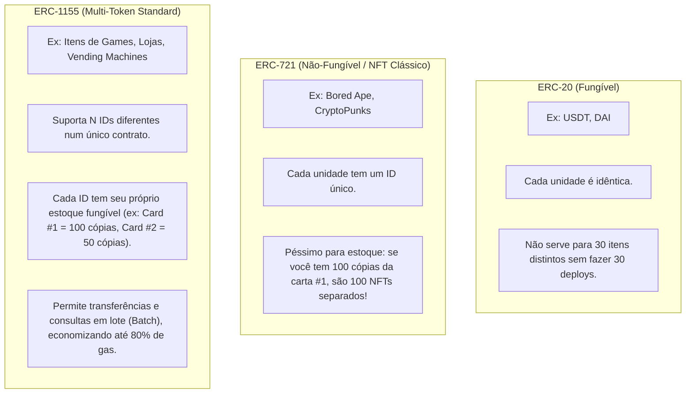

# Módulo 05: Projeto do Contrato — Vending Machine ERC-1155

> *"Por que gastar 30 deploys e fortunas em gas se você pode gerenciar um estoque inteiro de uma loja dentro de um único contrato multi-token?"*

---

## 1. Por que ERC-1155? A Escolha Técnica Certa

Em Ethereum, temos três grandes padrões para criação de ativos digitais:



Para a nossa **Vending Machine de 30 Cards (5 linhas x 6 colunas)**, o **ERC-1155 é o padrão ouro absoluto**:
- 1 único deploy de contrato.
- Cada card tem seu ID fixo (IDs de `1` a `30`).
- Cada card tem sua cota de estoque independente (ex: 50 unidades do Card #1, 10 unidades do Card #30 Raro).
- Cada card tem seu preço configurável.
- O comprador recebe o saldo do token ID específico diretamente na carteira.

---

## 2. Regras de Negócio da Vending Machine

Nossa máquina funciona exatamente como uma máquina física de salgadinhos/refrigerantes:

1. **Catálogo Fixo:**
   - Existem 30 slots numerados de 1 a 30 (grid 5x6).
   - O contrato valida estritamente: `cardId >= 1 && cardId <= 30`.

2. **Compra de 1 em 1, com pagamento exato:**
   - O usuário escolhe o Card; cada compra entrega exatamente 1 unidade (não existe campo de quantidade).
   - Envia o valor em ETH/Wei da transação (`msg.value`), que precisa ser exatamente o preço do card.
   - Se `msg.value` for diferente do preço, a transação reverte com `IncorrectPayment`. Por isso o contrato nunca devolve troco.

3. **Controle Estrito de Estoque, por card:**
   - Cada card tem o seu estoque (100 unidades no início). Antes de entregar, verifica se o card está ativo e se `stock > 0`.
   - Se o estoque acabou, reverte com `CardIsSoldOut`.
   - Ao vender, decrementa o estoque do card e emite o token ERC-1155 diretamente para o comprador (`_mint`).

4. **Eventos para a Experiência 3D:**
   - Quando a compra é confirmada, o contrato emite o evento:
     ```solidity
     event CardPurchased(
         address indexed buyer,
         uint256 indexed cardId,
         uint256 amount,        // sempre 1
         uint256 totalCost,
         uint256 remainingStock
     );
     ```
   - O jogo 3D (a máquina na rua escura estilo PS1) escuta esse evento via WebSocket/RPC. No segundo em que o evento é emitido na cadeia, a câmera do jogo foca na gaveta, o som mecânico toca e o card escolhido cai liberado na gaveta!

5. **Administração Segura:**
   - Apenas o dono (`Owner`) pode criar cards novos, ligar ou desligar a venda de um card, pausar a máquina, ajustar royalties e trocar os endereços dos metadados. O preço e o estoque de um card já criado não mudam.
   - Apenas o dono pode sacar o faturamento acumulado em ETH da máquina (`withdraw`).
   - A posse só muda em duas etapas (`transferOwnership` + `acceptOwnership`), e `renounceOwnership` está desativado.

---

## 3. Escolha da Testnet e Como Obter Fundos Facilmente

Para a aula e testes práticos com os alunos, precisamos de uma rede EVM rápida e com faucet abundante.

### Opção 1 (Recomendada): Ethereum Sepolia Testnet
- **Chain ID:** `11155111`
- **Explorador:** [https://sepolia.etherscan.io](https://sepolia.etherscan.io)
- **Faucets Gratuitos:**
  1. **Google Cloud Web3 Faucet:** [cloud.google.com/application/web3/faucet/ethereum/sepolia](https://cloud.google.com/application/web3/faucet/ethereum/sepolia) (Não exige saldo na mainnet, muito confiável).
  2. **Sepolia PoW Faucet:** [sepolia-faucet.pk910.de](https://sepolia-faucet.pk910.de) (Mineração leve no navegador por 1 minuto para combater bots, sem necessidade de login ou saldo).
  3. **Alchemy Sepolia Faucet:** [sepoliafaucet.com](https://sepoliafaucet.com) (Exige conta gratuita na Alchemy).

### Opção 2 (Backup Imediato): Arbitrum Sepolia ou Base Sepolia
- Como são Layer 2 da Sepolia, o mesmo código e contrato funcionam sem nenhuma alteração.
- Taxas de gas praticamente nulas (fração de centavo de gas).

---

## 4. O Padrão de Metadados e IPFS (Preparação)

O ERC-1155 define um padrão universal de URI:
`https://ipfs.io/ipfs/{CID}/{id}.json` ou `ipfs://{CID}/{id}.json`

Na especificação, o cliente substitui `{id}` pelo ID do token em formato hexadecimal com 64 caracteres preenchido com zeros à esquerda (ex: `0000000000000000000000000000000000000000000000000000000000000001.json`).

Cada arquivo JSON conterá:
```json
{
  "name": "Zeru Retro Card #01",
  "description": "Card colecionável da Vending Machine dos anos 90.",
  "image": "ipfs://Qm.../01.png",
  "attributes": [
    { "trait_type": "Linha", "value": "1" },
    { "trait_type": "Coluna", "value": "1" }
  ]
}
```

Isso garante que, assim que o aluno comprar o card na máquina, ele já apareça com imagem e atributos em carteiras como MetaMask, Phantom, Rabby e no OpenSea de teste!
