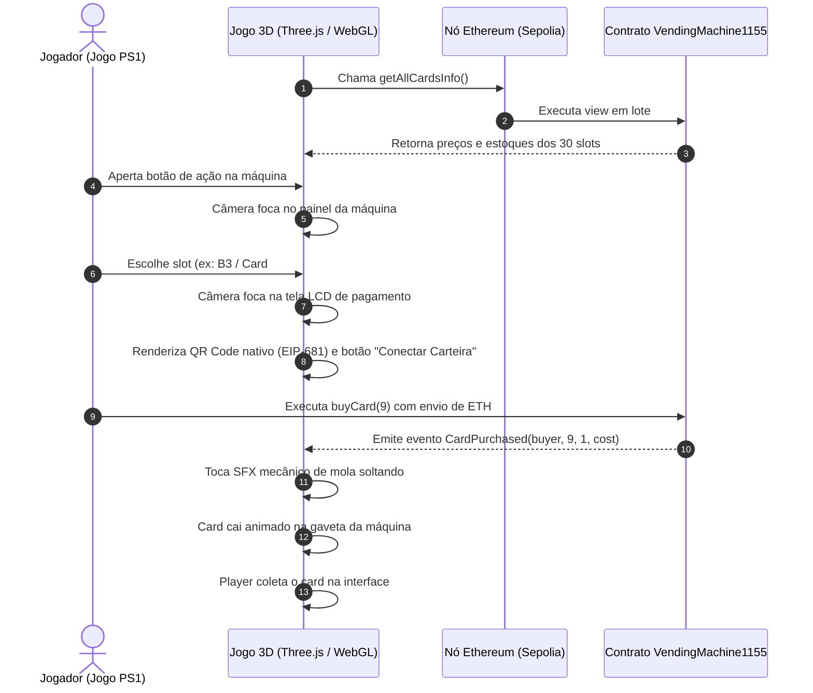

# Módulo 07: Especificação dos 30 Cards, Metadados IPFS e Integração com o Jogo 3D

> *"Como o contrato inteligente se conecta com a experiência 3D estilo PS1 no repositório dedicado."*

---

## 1. O Grid da Vending Machine (5 Linhas x 6 Colunas = 30 Itens)

A máquina na rua escura do jogo retro possui uma grade com 30 slots mecânicos visíveis através do vidro:

| Fileira | Slot 1 | Slot 2 | Slot 3 | Slot 4 | Slot 5 | Slot 6 |
| :---: | :---: | :---: | :---: | :---: | :---: | :---: |
| **Linha A (Topo)** | Card #01 | Card #02 | Card #03 | Card #04 | Card #05 | Card #06 |
| **Linha B** | Card #07 | Card #08 | Card #09 | Card #10 | Card #11 | Card #12 |
| **Linha C (Centro)** | Card #13 | Card #14 | Card #15 | Card #16 | Card #17 | Card #18 |
| **Linha D** | Card #19 | Card #20 | Card #21 | Card #22 | Card #23 | Card #24 |
| **Linha E (Base)** | Card #25 | Card #26 | Card #27 | Card #28 | Card #29 | Card #30 |

---

## 2. Padrão de Metadados ERC-1155 no IPFS

O ERC-1155 padroniza a substituição de `{id}` pelo ID formatado em hex com 64 dígitos minúsculos.  
Exemplo para o **Card #01**:  
URI resolvida: `ipfs://bafybei.../0000000000000000000000000000000000000000000000000000000000000001.json`

### Exemplo de Estrutura do Arquivo JSON:
```json
{
  "name": "Zeru Cyber Deck #01 - The Genesis Node",
  "description": "Card colecionável #01 obtido na Vending Machine retro.",
  "image": "ipfs://bafybeigameassets.../images/01.png",
  "external_url": "https://zeru-cards.eth.limo/cards/01",
  "attributes": [
    { "trait_type": "Grid Slot", "value": "A1" },
    { "trait_type": "Linha", "value": "A" },
    { "trait_type": "Coluna", "value": "1" },
    { "trait_type": "Edição", "value": "Retro 1998" }
  ]
}
```

---

## 3. Fluxo de Interação da Experiência 3D (Repositório Separado)



---

## 4. O QR Code de Pagamento On-Chain (EIP-681)

O QR Code gerado na telinha da máquina segue o padrão **EIP-681** para URLs de pagamento EVM:

```text
ethereum:<ENDERECO_DO_CONTRATO>@11155111/buyCard?uint256=9&value=4600000000000000
```

Isso permite que:
1. O usuário que está jogando no PC possa simplesmente apontar a câmera do celular (com MetaMask Mobile, Rainbow ou Rabby) para a tela do jogo.
2. O app da carteira abre diretamente com a função `buyCard(9)` e o valor de 0,0046 ETH preenchidos.
3. Ou, se preferir, clica no botão "Pagar com Carteira do Navegador" e a extensão do navegador abre para aprovação.
